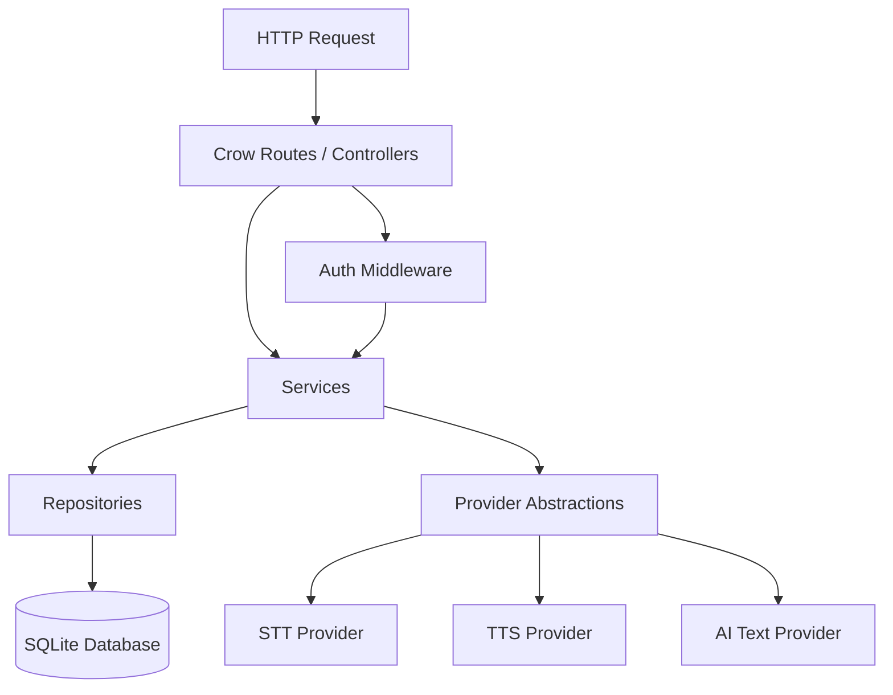
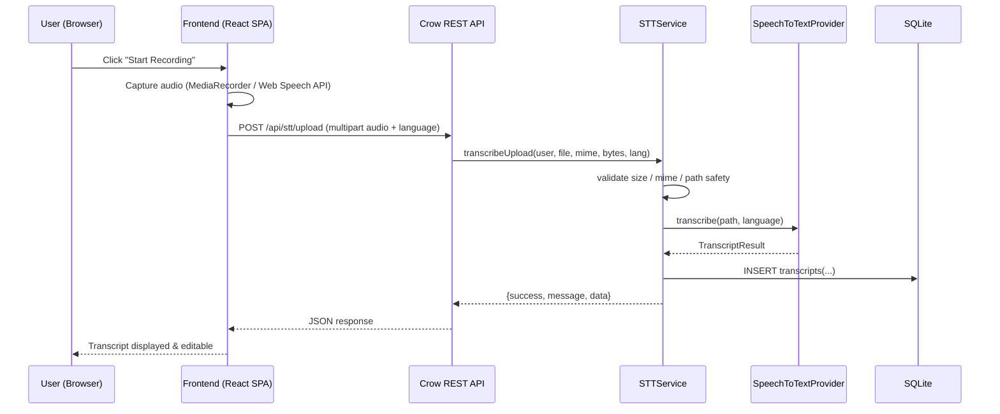
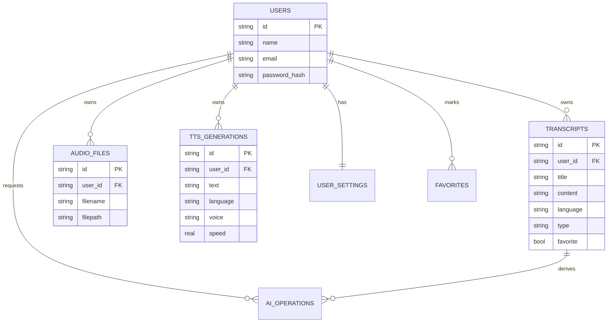

# VoiceText AI — Architecture

## 1. Layered backend architecture

## 2. Request lifecycle (Voice → Text)

## 3. Domain model (ER diagram)

## 4. Provider abstraction (replaceable AI backends)

`SpeechToTextProvider`, `TextToSpeechProvider`, and `AITextService` are pure
C++ interfaces. The application ships a `Mock*` implementation of each so it
runs in **Demo Mode** out of the box. Production deployments implement the
same interface against a real engine (local Whisper.cpp model, a cloud STT
API, a neural TTS engine, or an LLM) and swap it in via the `*_PROVIDER`
environment variable — no controller/service/route code changes needed.

## 5. Frontend ⇄ backend contract

The React frontend (`src/`) talks to the backend exclusively through the REST
API documented in the root `README.md`. In this hosted preview environment
(no C++ runtime available), `src/lib/api.ts` automatically falls back to an
in-browser **Demo Mode** that reproduces the exact same
`{ success, message, data }` envelope using `localStorage` and the browser's
native Web Speech API — so the UI, state management, and workflows are
identical to what you get when the real backend is running locally.
